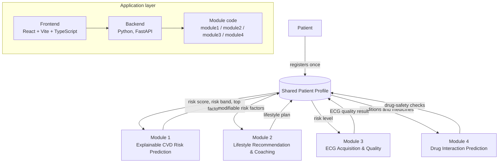

# CardioLoop: An Integrated AI Framework for Cardiovascular Health Management

One platform that predicts, explains and helps manage cardiovascular disease (CVD) risk for a patient.

- **Project ID:** J26-IT-322
- **Institution:** SLIIT, Faculty of Computing, IT4010 Research Project
- **Supervisor:** Prof. Sanvitha Kasthuriaarachchi
- **Co-supervisor:** Ms. Thisara Shyamalee

---

## Overview

CVD care is often fragmented: risk assessment, lifestyle coaching, ECG monitoring and medicine safety checks usually happen in separate tools that do not share information. Many risk tools give a number without explaining it, so patients and clinicians cannot see which factors drive the risk or which ones can be changed. Privacy rules also limit how patient data can be shared between hospitals, which makes it hard to train and validate models on enough data.

CardioLoop addresses this with four connected AI modules built around a single **Shared Patient Profile**. The patient registers once; each module reads from the profile and adds its own output for the others to use. Module 1 produces an explainable risk estimate (including a federated learning approach that keeps data inside each hospital), Module 2 turns modifiable risk factors into daily lifestyle coaching, Module 3 checks ECG recording quality before rhythm analysis, and Module 4 checks the patient's medicines for drug interactions with explanations.

---

## Team and modules

| Module | Component | Member | ID |
|---|---|---|---|
| 1 | [Explainable CVD Risk Prediction using ML Models and Federated GNN](module1/) | Jang R G | IT23178472 |
| 2 | [Personalised CVD Lifestyle Recommendation & Adaptive Coaching](module2_Data_Train/) | Hashinika P A D A J | IT23179462 |
| 3 | [AI-Powered Intelligent ECG Acquisition & Patient Action Support Platform](module3/) | Athapaththu A L D P | IT23386686 |
| 4 | [Explainable GNN Framework for Cardiac Drug Interaction Prediction](module4/) | Arachchi N A U D | IT23194458 |

---

## System architecture



The Shared Patient Profile integration is planned work. Currently the backend ([backend/main.py](backend/main.py)) exposes Module 2 only; Modules 1 and 4 list FastAPI integration as future work in their READMEs.

---

## Repository structure

```
J26_IT_322/
├── module1/              Module 1: explainable CVD risk prediction (notebooks, src, tests, Streamlit demo)
├── module2_Data_Train/   Module 2: lifestyle recommendation models, training code, reports and tests
├── module3/              Module 3: ECG preprocessing, quality features, 1D ResNet quality gate, pipeline runner
├── module4/              Module 4: drug knowledge graph, GNN, explanation engine, Streamlit demo, tests
├── frontend/             React + Vite + TypeScript web app (currently contains the Module 2 UI in src/module2/)
├── backend/              FastAPI backend (main.py), SQLite helpers (database.py), video analysis (video_analyzer.py)
├── run_backend.py        Starts the FastAPI backend with uvicorn
├── .gitignore
└── README.md
```

---

## Getting started

### Prerequisites

| Tool | Version | Source |
|---|---|---|
| Python | 3.13 for Module 1 (stated in `module1/requirements.txt`); other modules: TBD | module requirements files |
| Node.js | TBD (not specified in the repo; `frontend/package.json` has no `engines` field) | `frontend/package.json` |
| macOS only | `brew install libomp` (needed by XGBoost) | Module 1 README |

### Clone the repository

```bash
git clone https://github.com/RanugiJang/J26_IT_322.git
cd J26_IT_322
```

### Python environments: one per module

Each module has its own `requirements.txt` with different, sometimes conflicting, versions. Use a **separate virtual environment per module**, created inside that module's folder:

```bash
cd module1                       # or module2_Data_Train, module3, module4
python3 -m venv .venv
source .venv/bin/activate        # Windows: .venv\Scripts\activate
pip install -r requirements.txt
```

Deactivate (`deactivate`) before switching to another module.

### Frontend

Scripts in [frontend/package.json](frontend/package.json): `dev`, `build`, `preview`, `backend`.

```bash
cd frontend
npm install
npm run dev        # start the Vite dev server
npm run build      # production build
npm run preview    # preview the production build
```

### Backend

The backend is a FastAPI app in [backend/main.py](backend/main.py), started by [run_backend.py](run_backend.py) with uvicorn on `127.0.0.1:8000` (auto-reload on).

```bash
# from the repo root
python run_backend.py

# or from frontend/
npm run backend
```

- API docs: http://127.0.0.1:8000/docs
- Health check: http://127.0.0.1:8000/api/health

Notes:

- Backend dependencies: TBD. There is no backend `requirements.txt`; the code imports `fastapi`, `uvicorn` and `pydantic`, plus Module 2 code.
- `backend/main.py` imports Module 2 as `module2.src...` and loads models from `module2/models/`, but the folder in this repo is `module2_Data_Train/`. How this is resolved: TBD.

---

## Running each module

Full details, data steps and options are in each module's README.

### Module 1: Explainable CVD Risk Prediction

See [module1/README.md](module1/README.md). Run from the repo root:

```bash
python module1/src/module1.py        # train the model and print an example profile
streamlit run module1/src/app.py     # demo app (http://localhost:8501)
pytest module1/tests -v              # tests
```

### Module 2: Lifestyle Recommendation & Adaptive Coaching

See [module2_Data_Train/README.md](module2_Data_Train/README.md) and the frontend notes in [frontend/src/module2/README.md](frontend/src/module2/README.md). Commands as written in the module README:

```bash
python -m pytest module2/tests -v                    # unit tests
python -m module2.src.pipeline.lifestyle_engine      # end-to-end coach pipeline demo
```

The README refers to `module2/`; in this repo the folder is `module2_Data_Train/`. Exact paths for this repo: TBD.

### Module 3: ECG Acquisition & Quality Assessment

See [module3/README.md](module3/README.md). Run from inside `module3/`:

```bash
python src/utils/downloader.py       # download ECG datasets
python run_pipeline.py               # rule-based pipeline (no trained model needed)
python run_pipeline.py --use-model   # pipeline with the trained model
```

Tests: TBD (the README mentions a `tests/` folder, but none is in the repo yet).

### Module 4: Cardiac Drug Interaction Prediction

See [module4/README.md](module4/README.md). Run from inside `module4/`:

```bash
python -m pytest -q                  # tests
streamlit run app.py                 # demo app (http://localhost:8501)
```

---

## Data and privacy

- Patient data and licensed datasets **must not be committed** to this public repository.
- Each module's README explains where its data comes from and how to download or request it.
- Keep downloaded data inside the module's local data folder and make sure it is git-ignored.
- Where to get Module 2's data: TBD (not described in the Module 2 README).

---

## Branching and contribution workflow

1. Each member works on their own feature branch (for example `feature/<module-name>`), never directly on `main`.
2. Pull `main` into your branch regularly to stay up to date:
   ```bash
   git checkout <your-branch>
   git pull origin main
   ```
3. Never commit datasets, virtual environments (`venv/`, `.venv/`), generated outputs or large model files.
4. Run your module's tests before opening a pull request.
5. Open a pull request from your branch to `main` and ask a teammate to review it.

---

## Project status

Based only on what each module README states.

### Module 1

| Item | Status |
|---|---|
| Research notebooks 01–10 (baseline, federated, GNN, uncertainty, causal, LSTM trend, baselines, ablation, explanations) | Done |
| `predict_patient()` API, Streamlit demo, tests | Done |
| Validation on Sri Lankan data | In progress (pending approval) |
| `risk_trend` from visit history | In progress (needs shared database) |
| FastAPI endpoint for CardioLoop | In progress (planned after PP1) |
| Polygenic risk score | Future work |

### Module 2

| Item | Status |
|---|---|
| Lifestyle ranking, smoking stage, exercise prescription, CA-CJAT and DQN models | Done (trained models and reports listed in README) |
| Unit tests | Done (README states 9/9 passing) |
| Frontend dashboard and FastAPI backend | TBD |

### Module 3

| Item | Status |
|---|---|
| Overall status | TBD (not stated in the Module 3 README) |

### Module 4

| Item | Status |
|---|---|
| 1. Data acquisition | Done |
| 2. Entity resolution and knowledge graph | Done |
| 3. Splits and baselines | Done |
| 4. GNN (GATv2), mechanism head, MC-dropout confidence | Done |
| 5. Explanations, safer alternatives, pharmacogenomic alerts | Done |
| 6. Demo app (Streamlit) | In progress (PP1) |
| 7. FAERS cross-check and population transferability | Planned |
| 8. Clinician evaluation of explanations | Planned |
| 9. Shared Patient Profile integration (FastAPI) | Planned |

---

## Acknowledgements

- **SLIIT Faculty of Computing**, IT4010 Research Project.
- **Prof. Sanvitha Kasthuriaarachchi** (supervisor) and **Ms. Thisara Shyamalee** (co-supervisor).
- Dataset and resource providers named in the module READMEs:
  - Module 1: Framingham Heart Study (via Kaggle), `riskCommunicator` R package, UCI Heart Disease dataset.
  - Module 2: ACC/AHA and BACPR cardiac rehabilitation cohort (as named in the Module 2 README).
  - Module 3: PhysioNet (MIT-BIH Arrhythmia Database, MIT-BIH Noise Stress Test Database).
  - Module 4: DrugBank (via TDC), DDInter, ClinPGx (PharmGKB), gnomAD v4, 1000 Genomes, FAERS.
