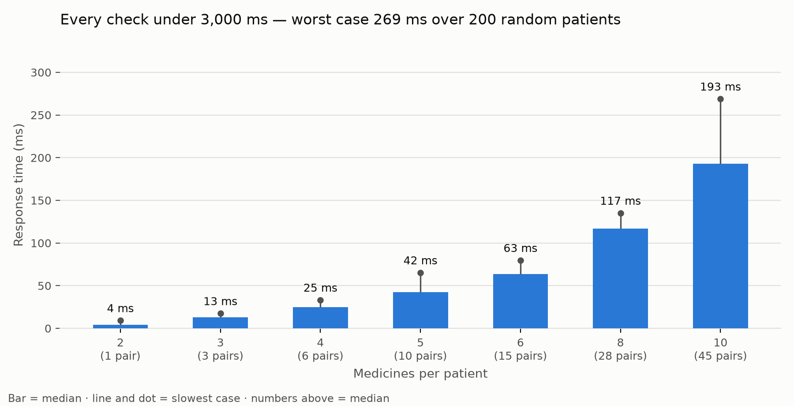

# Module 4 — Response-time test

Requirement: each interaction check returns in under **3,000 ms**. **✅ PASS**

- Cases: 200 random patients (2–10 medicines, ~70% cardiac drugs, half with a genotype)
- Machine: Darwin arm64, Python 3.11.17
- Engine start-up (once, when the app opens): 1.7 s

| Measure | Time |
|---|---|
| Median | 42.3 ms |
| 95th percentile | 200.4 ms |
| Worst case | 268.8 ms |
| Checks under 3,000 ms | 100% |

## By number of medicines

| Medicines | Drug pairs | Cases | Median | 95th pct | Worst |
|---|---|---|---|---|---|
| 2 | 1 | 29 | 4.0 ms | 5.2 ms | 9.2 ms |
| 3 | 3 | 29 | 12.9 ms | 15.3 ms | 17.4 ms |
| 4 | 6 | 29 | 24.9 ms | 31.1 ms | 33.2 ms |
| 5 | 10 | 29 | 42.4 ms | 57.3 ms | 65.2 ms |
| 6 | 15 | 28 | 63.5 ms | 75.3 ms | 79.7 ms |
| 8 | 28 | 28 | 116.9 ms | 134.1 ms | 135.0 ms |
| 10 | 45 | 28 | 193.0 ms | 239.8 ms | 268.8 ms |

Each check includes scoring every pair with Monte-Carlo dropout, explanations, safer-alternative search and pharmacogenomic alerts — the same call the demo makes.

